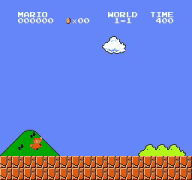
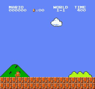

# 🍄 Super Mario Bros RL Agent (Stage 1-1 Autonomous Clear)

[](https://www.python.org/)
[](https://pytorch.org/)
[](https://github.com/DLR-RM/stable-baselines3)
[](https://gymnasium.farama.org/)
[](#)

PPO(Proximal Policy Optimization) 심층 강화학습과 화면 픽셀 기반 이산 행동 제어를 결합하여 **슈퍼 마리오 브라더스(NES) 월드 1-1을 자율 클리어**하는 강화학습 프로젝트입니다. 

초반 장애물 극복부터 후반부 계단 피라미드 정체(Stagnation / Freezing) 문제까지 해결할 수 있도록 설계된 **커스텀 보상 체계(Custom Reward Shaping)**와 **2단계 점진적 학습 파이프라인**을 제공합니다.

---

## 🎬 1. 모델별 플레이 결과 및 영상 비교

훈련 단계 및 보상 설계에 따른 에이전트의 플레이 양상을 비교 분석한 결과입니다.

| 모델 구분 | 학습 상태 | 최대 도달 거리 ($X$) | 주요 양상 및 결과 분석 | 플레이 시연 (Demo GIF) |
|:---|:---:|:---:|:---|:---:|
| **1. 미학습 모델<br>(Untrained)** | 무작위 행동<br>(Random Policy) | $X \approx 200 \sim 686$ | • 방향 감각 없이 제자리 점프와 무작위 걷기 반복<br>• 첫 번째 굼바 또는 파이프 앞에서 즉시 사망 |  |
| **2. 중간 학습 모델<br>(Baseline 500K)** | PPO 기본 학습<br>(50만 스텝) | $X \approx 400 \sim 1,200$ | • 우측 전진 보상을 인지하여 파이프를 일부 뛰어넘음<br>• 연속 적 등장 또는 구덩이 낙사 구간에서 탈락 |  |
| **3. 계단 고착 모델<br>(Deterministic 1.9M)** | 190만 스텝<br>(결정론적 추론) | $X = 2,978$<br>*(스테이지 95% 지점)* | • 모든 굼바, 파이프, 낙사 구덩이를 능숙하게 돌파<br>• 계단 6단 턱에서 `right` 전진만 고집하며 250초간 타임아웃 굳음(Freezing) |  |
| **4. 최종 클리어 모델<br>(Custom Reward 1.9M)** | 커스텀 보상 적용<br>(확률적 점프 탐색) | **$X = 3,161$<br>*(100% 클리어 🏁)*** | • 계단 구간 점프 인센티브 및 마일스톤 보상 작동<br>• 피라미드 8단 꼭대기 점령 후 깃대로 다이빙하여 **완벽 클리어** |  |

> 💡 **주요 분석 인사이트**:
> - 190만 스텝 시점에서 에이전트는 이미 스테이지의 95%를 주파하는 능력을 갖추었으나, 최고 확률 행동만 선택하는 결정론적(`deterministic=True`) 추론 시 계단 벽에 비비는 Local Minima에 갇혔습니다.
> - 계단 구간($X \ge 2800$)의 **점프 유도 보상**과 **확률적 행동 샘플링(`deterministic=False`)**을 허용함으로써 계단 8단을 뛰어오르고 깃대를 잡아채는 자율 클리어가 완성되었습니다.

---

## 📑 목차
1. [프로젝트 개요](#1-프로젝트-개요)
2. [디렉토리 구조](#2-디렉토리-구조)
3. [환경 설정 및 설치](#3-환경-설정-및-설치)
4. [신경망 구조 및 파라미터 분석](#4-신경망-구조-및-파라미터-분석)
5. [환경 전처리 파이프라인](#5-환경-전처리-파이프라인)
6. [행동 공간 (Action Space)](#6-행동-공간-action-space)
7. [커스텀 보상 체계 (Reward Engineering)](#7-커스텀-보상-체계-reward-engineering)
8. [실행 및 시각화 가이드](#8-실행-및-시각화-가이드)
9. [학습 추이 및 벤치마크 지표](#9-학습-추이-및-벤치마크-지표)

---

## 1. 프로젝트 개요

- **타겟 환경**: `gym-super-mario-bros` (`SuperMarioBros-1-1-v0`)
- **알고리즘**: PPO (Proximal Policy Optimization) via `Stable-Baselines3`
- **핵심 목표**: 월드 1-1의 장애물, 굼바/엉금엉금 회피 및 후반부 계단 장애물을 넘어 최종 깃대(Flagpole) 터치 및 클리어
- **학습 특징**:
  - 8개 서브프로세스를 활용한 고속 병렬 데이터 수집 (`SubprocVecEnv`, ~630 FPS)
  - 4-프레임 스킵 + 4-프레임 스택 시계열 비전 처리
  - 후반부 정체 현상 방지 및 깃대 다이빙을 유도하는 정밀 보상 설계
  - 베이스 훈련(2.0M 스텝) 후 취약 구간을 보완하는 파인튜닝 기법 적용
  - 웹 브라우저를 통한 실시간 저지연 플레이 스트리밍 지원 (`web_play.py`)

---

## 2. 디렉토리 구조

```plaintext
d:/mario/
├── assets/                     # 시연 GIF 및 MP4 데모 영상
│   ├── demo_untrained.gif
│   ├── demo_baseline_500k.gif
│   ├── demo_staircase_freeze.gif
│   └── demo_stage_clear.gif
├── envs/
│   ├── __init__.py
│   ├── wrappers.py             # Gymnasium 변환, 프레임스킵, 흑백 리사이징 래퍼
│   └── reward_wrappers.py      # 계단 돌파 및 깃대 클리어 유도 커스텀 보상 래퍼
├── models/                     # 학습된 PPO 모델 체크포인트
│   ├── mario_run_1/            # 1단계 베이스 학습 체크포인트 (10만~200만 스텝)
│   ├── mario_finetune_1/       # 1차 파인튜닝 모델
│   └── mario_finetune_2/       # 2차 정밀 파인튜닝 모델 (최종 클리어 모델)
├── logs/                       # TensorBoard 로그 디렉토리
├── train.py                    # 1단계 베이스 PPO 학습 스크립트 (2M 스텝)
├── train_finetune.py           # 2단계 정밀 파인튜닝 스크립트 (150K 스텝)
├── test_env.py                 # 환경 래퍼 동작 및 FPS 벤치마크 테스트
├── test_190.py                 # 체크포인트 평가 및 성공률 테스트 스크립트
├── record_demos.py             # 모델별 데모 영상 및 GIF 자동 생성 스크립트
├── web_play.py                 # 웹 기반 실시간 MJPEG 비디오 스트리밍 플레이어
├── play.py                     # Pygame 기반 실시간 렌더링 플레이어
├── requirements.txt            # 필수 파이썬 패키지 명세
└── README.md                   # 프로젝트 상세 설명 문서
```

---

## 3. 환경 설정 및 설치

본 프로젝트는 Windows 호스트와 WSL2(Ubuntu 24.04 LTS)의 GPU 가속(CUDA) 환경에서 최적화되었습니다.

### 3.1 권장 실행 사양
- **GPU**: NVIDIA RTX 4080 / 3060 이상 (VRAM 4GB 이상 권장, CUDA 지원 필수)
- **CPU**: 8코어 16스레드 이상 권장 (에뮬레이터 8병렬 수집을 위함)
- **OS**: WSL2 (Ubuntu 22.04 / 24.04) or Linux

### 3.2 의존성 설치 가이드

```bash
# 1. 저장소 클론
git clone https://github.com/Danpun9/super-maRlo.git
cd super-maRlo

# 2. C++ 에뮬레이터 빌드 도구 확인 (WSL / Ubuntu)
sudo apt update && sudo apt install -y build-essential

# 3. Python 3.10 가상환경 생성 (Conda 또는 uv 권장)
# Option A: Conda
conda create -n mario_rl python=3.10 -y
conda activate mario_rl

# Option B: uv
uv venv --python 3.10 .venv
source .venv/bin/activate

# 4. 필수 라이브러리 설치
pip install -r requirements.txt
```

> **버전 호환성 유의사항**:
> - `nes-py`는 C++ 빌드와 `numpy < 2.0.0` 호환성을 요구하므로 `numpy==1.26.4` 및 `opencv-python==4.9.0.80`이 권장됩니다.
> - 최신 Farama `gymnasium`과 레거시 `gym` 간의 호환은 자체 구현된 `GymToGymnasiumWrapper`가 브릿지 역할을 수행합니다.

---

## 4. 신경망 구조 및 파라미터 분석

Stable-Baselines3의 `ActorCriticCnnPolicy`를 사용하며, DeepMind의 대표적인 **NatureCNN** 구조가 정책망(Actor)과 가치망(Critic)의 특징 추출기(Feature Extractor)를 공유합니다.

```
입력 프레임: (Batch, 4, 84, 84)
  │
  ├─► Conv2d(in=4, out=32, kernel=8x8, stride=4) + ReLU   ──► (32, 20, 20)
  ├─► Conv2d(in=32, out=64, kernel=4x4, stride=2) + ReLU  ──► (64, 9, 9)
  ├─► Conv2d(in=64, out=64, kernel=3x3, stride=1) + ReLU  ──► (64, 7, 7)
  ├─► Flatten()                                           ──► 3,136 차원
  └─► Linear(in=3136, out=512) + ReLU                     ──► 512 차원 잠재 벡터 (Shared)
        │
        ├─► Actor Head:  Linear(512, 7)  ──► 7개 이산 행동 로짓 (Logits)
        └─► Critic Head: Linear(512, 1)  ──► 상태 가치 평가 V(s)
```

### 파라미터 상세 분석

| 컴포넌트 | 세부 계층 | 파라미터 수식 | 파라미터 수 |
|---|---|---|---:|
| **특징 추출기**<br>(`NatureCNN`) | Conv1 (8×8, Stride 4) | $(4 \times 8 \times 8 \times 32) + 32$ | 8,224 |
| | Conv2 (4×4, Stride 2) | $(32 \times 4 \times 4 \times 64) + 64$ | 32,832 |
| | Conv3 (3×3, Stride 1) | $(64 \times 3 \times 3 \times 64) + 64$ | 36,928 |
| | Linear (Dense 512) | $(3,136 \times 512) + 512$ | 1,606,144 |
| **Actor Head** | Linear (Dense 7) | $(512 \times 7) + 7$ | 3,591 |
| **Critic Head** | Linear (Dense 1) | $(512 \times 1) + 1$ | 513 |
| **총 파라미터 수** | | | **1,688,232개 (약 1.69M)** |

- **가중치 메모리 크기**: FP32 기준 약 **6.44 MB**
- **체크포인트 파일 크기**: 모델 파라미터 + Adam 옵티마이저 모멘텀 상태 포함 약 **20.7 MB** (`.zip`)

---

## 5. 환경 전처리 파이프라인

원활하고 빠른 CNN 시각 학습을 위해 [`envs/wrappers.py`](envs/wrappers.py)에서 다음과 같은 계층적 래핑을 적용합니다.

1. **`GymToGymnasiumWrapper`**:
   - 구형 OpenAI Gym API(튜플 4개 반환)를 최신 Farama Gymnasium API(`obs, rew, term, trunc, info` 5개 반환)로 양방향 호환 변환합니다.
2. **`SkipFrame(skip=4)`**:
   - 4프레임 동안 동일한 행동을 유지하고 누적 보상을 반환합니다.
   - NES 에뮬레이터 특유의 스프라이트 깜빡임(Flicker)으로 인해 마리오가 사라져 보이는 현상을 방지하고자 **최근 2개 프레임의 Element-wise Max pooling**을 취합니다.
3. **`GrayScaleResizeObservation(shape=84)`**:
   - NES 원본 컬러 화면 ($240 \times 256 \times 3$)을 OpenCV를 통해 흑백 Grayscale로 변환 후 $84 \times 84$ 크기로 다운샘플링합니다 (`(1, 84, 84)`).
4. **`VecFrameStack(n_stack=4, channels_order='first')`**:
   - 직전 4개의 프레임을 시간축으로 적층하여 최종 입력 텐서 `(4, 84, 84)`를 만듭니다.
   - 이를 통해 1장의 정지 영상으로는 알 수 없는 **마리오의 이동 속도, 관성, 점프 하강 속도, 적의 이동 방향**을 모델이 파악할 수 있습니다.

---

## 6. 행동 공간 (Action Space)

NES 패드의 복잡한 전체 256개 입력 조합 대신 필수적인 7가지 행동을 추린 **`SIMPLE_MOVEMENT`** (Discrete 7)를 채택했습니다.

| 인덱스 | 키 조합 | 명칭 및 역할 |
|:---:|:---|:---|
| `0` | `['NOOP']` | 정지 (조작 없음) |
| `1` | `['right']` | 오른쪽 걷기 |
| `2` | `['right', 'A']` | 오른쪽 점프 (기본 점프) |
| `3` | `['right', 'B']` | 오른쪽 대시 (달리기) |
| `4` | `['right', 'A', 'B']` | 오른쪽 전속력 대시 점프 (롱 점프) |
| `5` | `['A']` | 제자리 점프 |
| `6` | `['left']` | 왼쪽 이동 (후진) |

---

## 7. 커스텀 보상 체계 (Reward Engineering)

기본 게임 보상(단순 X좌표 차이)만으로는 깃대 앞 거대한 피라미드 블록 계단($x \ge 2800$) 앞에서 전진하지 못하고 제자리에서 멈칫거리는 **Freezing 현상**이 발생합니다. 이를 극복하기 위해 [`envs/reward_wrappers.py`](envs/reward_wrappers.py)에 정밀 보상 로직이 구현되어 있습니다.

### 보상 함수 세부 구성

1. **전진 및 후진 보상**:
   - 일반 구간 전진: $\Delta x \times 1.0$
   - 계단 돌파 구간 ($x \ge 2800$) 전진: $\Delta x \times 3.0$ (강력한 전진 동기 부여)
   - 후진 이동: $\Delta x \times 1.5$ (뒤로 돌아갈 시 감점)
2. **정체(Stagnation) 억제 및 조기 종료**:
   - 일반 구간: 30스텝 이상 최대 도달 거리 미갱신 시 매 스텝 `-0.5`, 100스텝 정체 시 에피소드 강제 종료(Truncation) 및 `-10.0`
   - 계단 구간 ($x \ge 2800$):
     - 점프 행동(`right+A`, `right+A+B`)에 `+2.0` 보너스
     - 점프 없이 벽에 비비는 행동(`right`)에 `-1.0` 페널티
     - 15스텝 정체 시 매 스텝 `-3.0`, 45스텝(~1.5초) 정체 시 즉시 강제 종료 및 `-30.0`
3. **계단 등반 및 다이빙 마일스톤**:
   - $x > 3000$ 진입: `+40.0`
   - $x > 3050$ (계단 정상 도달): `+80.0`
   - $x > 3100$ (정상에서 깃대로 하강 점프): `+150.0`
4. **스코어 및 종료 보상**:
   - 몬스터 처치 및 코인 획득: $\Delta \text{score} \times 0.05$
   - 사망/낙사: `-50.0`
   - **깃대 클리어 (`flag_get`)**: **`+500.0` 잭팟 보너스**
5. **보상 정규화 (Reward Scaling)**:
   - 최종 계산된 총합 보상을 `10.0`으로 나누어 PPO 가치망(Value Loss)의 발산을 방지하고 학습 안정성을 보장합니다.

---

## 8. 실행 및 시각화 가이드

### 8.1 환경 진단 및 테스트
```bash
python test_env.py
```

### 8.2 베이스 훈련 (0 ~ 200만 스텝)
```bash
python train.py \
    --num_envs 8 \
    --total_steps 2000000 \
    --lr 1e-4 \
    --exp_name mario_run_1
```

### 8.3 정밀 파인튜닝 (계단 극복 및 클리어 유도)
```bash
python train_finetune.py \
    --base_model models/mario_run_1/mario_ppo_1900000_steps.zip \
    --num_envs 8 \
    --total_steps 150000 \
    --lr 2e-5 \
    --ent_coef 0.005 \
    --exp_name mario_finetune_2
```

### 8.4 웹 브라우저 실시간 스트리밍 시각화
WSL 내부에서 게임을 렌더링하고, 호스트 Windows 웹 브라우저에서 실시간으로 관람할 수 있습니다.
```bash
python web_play.py \
    --model models/mario_run_1/mario_ppo_1900000_steps.zip \
    --port 5000 \
    --fps 30
```
- 브라우저 접속: `http://localhost:5000`
- 에피소드, 현재 X좌표, 최고 기록, 목숨, 점수 및 OSD 오버레이가 포함된 고화질(768x720) 영상이 실시간 스트리밍됩니다.

### 8.5 데모 영상 및 GIF 생성
```bash
python record_demos.py
```

---

## 9. 학습 추이 및 벤치마크 지표

TensorBoard를 통해 모니터링된 핵심 학습 곡선 지표입니다.

```bash
tensorboard --logdir=logs --bind_all --load_fast=false
```

- **`train/explained_variance`**: $0.4 \to 0.95$로 상승 (Critic 가치망이 환경의 위험과 기회를 95% 정확도로 예측)
- **`train/entropy_loss`**: $-1.94 \to -0.65$ 수렴 (무작위 조작을 멈추고 목적 지향적인 주행 행동으로 압축)
- **수집 속도 (FPS)**: RTX 4080 SUPER 및 8개 병렬 서브프로세스 기준 **~630 FPS** 달성 (200만 스텝 학습에 약 50분 소요)
